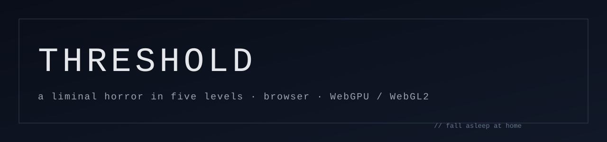
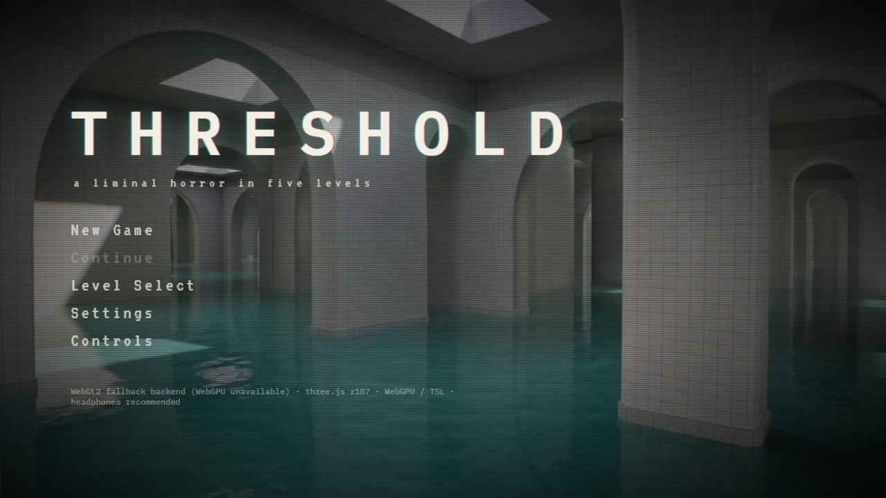
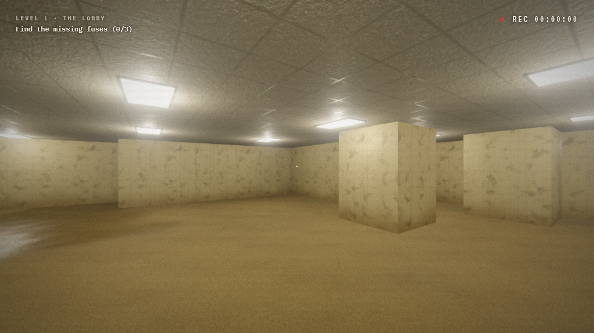
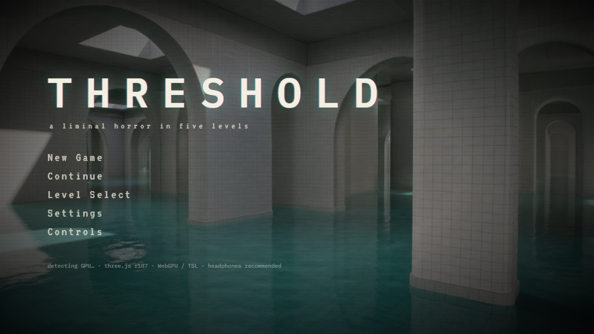
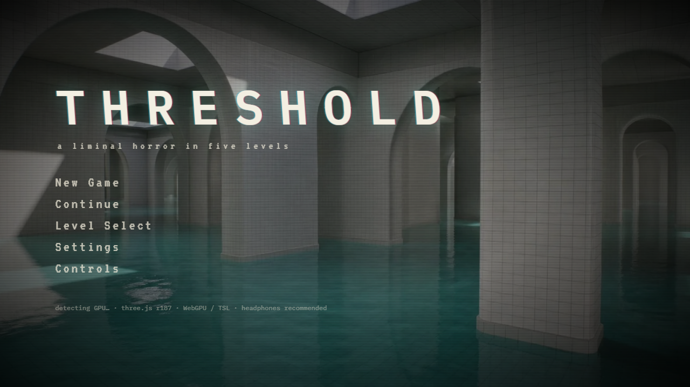

<p align="center">
  
</p>

<h1 align="center">THRESHOLD :: a liminal horror in five levels</h1>

<p align="center"><strong>You fall asleep at home. You wake up somewhere else.</strong> A first-person liminal-space exploration game for the browser — no install, no engine download, just open a URL.</p>

<p align="center">
  <a href="LICENSE"></a>
  
  
  
  
  
</p>

<pre>
IDENT   :: THRESHOLD
CLASS   :: First-person liminal horror (browser)
STATUS  :: ⚠ EXPERIMENTAL (prototype)
STACK   :: Vanilla ES modules · three.js r187 (WebGPU + WebGL2 fallback) · TSL node materials
LINK    :: https://github.com/Nortaq-PlayNexus/threshold
</pre>

## // 01 :: Signal

**THRESHOLD** is a single-page browser game inspired by liminal-space exploration: sterile tile corridors, flooded rooms, looping hallways, and long walks toward something that feels almost like an exit. It is a small, self-contained prototype: no bundler required at runtime, assets included, audio generated procedurally in the Web Audio API.

This project is an homage to the mood of games like *Liminality* (Lory Games). It is **not affiliated with, endorsed by, or a replacement for** those works.

## // 02 :: Capabilities

| Area | What is here |
|------|----------------|
| Rendering | `WebGPURenderer` via `three/webgpu` with automatic WebGL2 fallback (see in-app GPU notice) |
| Shading | TSL node materials throughout (`three/tsl`) |
| Lighting | Clustered Forward+ (`ClusteredLighting`) for dense point-light scenes (Lobby) |
| Post / effects | Render pipeline: GTAO, TRAA (Ultra), FXAA/SMAA-style paths per quality tier, bloom, custom VHS/film TSL pass (fear/glitch/damage/underwater uniforms) |
| Water | Depth-based absorption, planar reflections, dual normal maps, TSL caustics on tiled surfaces below waterline |
| Detail | Procedural surfaces in TSL (wet patches, staining, algae lines), noise-dissolve for entities, instanced grass on the Hill |
| Textures / sky | 2K PBR sets from [ambientCG](https://ambientcg.com/) (CC0), Poly Haven HDRI sky (CC0) |
| Audio | 100% procedural Web Audio (HRTF panning, convolution reverb per level, underwater muffling) |
| AI | BFS flow-field navigation on a grid, line-of-sight, hearing (sprint/wading loud) |
| Persistence | `localStorage` (unlocked levels, settings, deaths, time) |

## Screenshots

Real captures from the current build (served locally, low quality preset for capture where noted).

<p align="center">
  
</p>
<p align="center"><em>Main menu</em></p>

<p align="center">
  
</p>
<p align="center"><em>Level 1 — The Lobby (capture)</em></p>

<p align="center">
  
</p>
<p align="center"><em>Level 2 — The Poolrooms (capture)</em></p>

<p align="center">
  
</p>
<p align="center"><em>Level 6 — The Hill (capture)</em></p>

## // 03 :: Quick start

You need a **modern browser** (Chrome/Edge with WebGPU when available; Safari 26+ / Firefox 141+ as noted in-app). Use any static HTTP server (the game loads ES modules and textures).

```bash
cd threshold
python3 serve.py
```

Then open <http://localhost:8080>.

Alternative (any static server):

```bash
npx serve .
# or: python3 -m http.server 8080
```

> **Note:** `serve.py` binds `0.0.0.0:8080` and sets no-cache headers for development. Some environments may already use port 8080; edit the port if needed.

## // 04 :: Controls

| Input | Action |
|-------|--------|
| W A S D | Move |
| Mouse | Look |
| Shift | Sprint (louder to threats) |
| C / Ctrl | Crouch (quieter) |
| E (hold) | Interact / pick up / read |
| F | Flashlight |
| Esc | Pause |

## // 05 :: URL options (debug / convenience)

| Param | Example | Effect |
|-------|---------|--------|
| `q` | `?q=ultra` `?q=high` `?q=low` | Quality preset override |
| `level` + `auto` | `?level=1&auto=1` | Jump to a level (auto skips pointer lock flow in some cases) |
| `unlock` | `?unlock=1` | Unlock all levels in level select (client-side) |

## // 06 :: Levels (as implemented)

| # | Level | Goal (summary) | Threat (summary) |
|---|-------|----------------|------------------|
| 1 | **The Lobby** | Find 3 fuses and power the elevator | The Hollow hunts during blackouts; flashlight can deter it (see in-game behavior) |
| 2 | **The Poolrooms** | Turn 3 red valves to drain the great pool, then take the tunnel | A watcher that tends to disappear when observed (per README/design notes) |
| 3 | **The Aqueduct** | Collect 4 photographs to unlock the north door | Mannequins that move when not looked at (classic weeping-angle style mechanic) |
| 4 | **Floor 8** | Looping hotel corridor: if there is an anomaly, turn back; if not, go forward. Clear a streak. | Multiple anomalies; one can chase you if you make mistakes (per design) |
| 5 | **The Deep End** | Pull 2 levers in flooded drains to raise the floodgate | The Hollow hunts by sound/light cues (per design) |
| 6 | **The Hill** | Walk up the hill and open the door | No combat threat listed |

See [`DESIGN.md`](DESIGN.md) for the full design document.

## // 07 :: Architecture (high level)

```
threshold/
├── index.html          # Entry, import map, UI overlays
├── serve.py            # Dev static server (Python)
├── css/                # Styles
├── js/
│   ├── main.js         # Boot, loop, menus, level loading
│   ├── renderer.js     # WebGPU/WebGL renderer, pipeline, post FX
│   ├── levels/         # l1_lobby … l6_hill
│   ├── audio.js        # Procedural Web Audio
│   └── …               # world, player, entities, water, props, ui, input, assets
├── assets/             # Textures, HDRI, images, fonts (local)
├── vendor/three/       # Vendored three.js r187 (ES modules)
└── docs/               # Screenshots, banner, project docs
```

More detail: [`docs/architecture.md`](docs/architecture.md).

## // 08 :: Development

- **No Node build step** for the app itself: it is static ESM. `package.json` lists `three` as a dependency metadata entry but the runtime uses files under `vendor/three/` and import maps in `index.html` — treat `npm install` as optional unless you are managing dependencies yourself.
- Local run: see Quick start (`serve.py` or any static server).
- Editing: refresh the browser. Use browser devtools for WebGPU/WebGL errors.

See [`docs/development.md`](docs/development.md).

## // 09 :: Deployment

This is a static site. Host the repository contents (or built output equivalent) on any static host (GitHub Pages, Netlify, Vercel static, etc.). Ensure correct MIME types for `.js`, `.woff2`, `.webp`, `.hdr`. For GitHub Pages, you may need to configure a workflow to publish from `main` (see [`docs/deployment.md`](docs/deployment.md)).

## // 10 :: Honest limitations

- **Experimental prototype.** Balance, bug counts, performance, and level polish vary by hardware and browser.
- **WebGPU support is uneven.** Some systems fall back to WebGL2; visuals and performance differ.
- **Performance-heavy scenes** (many lights, post-processing, large textures) can be demanding on integrated GPUs or mobile devices.
- **Screenshots in this repo** are captures from a development session (low/auto settings in some cases); they are not marketing renders.
- **No automated test suite** is included in this repository (`npm test` is a placeholder).
- **Vendor bundle** includes a large set of three.js addon files under `vendor/three/` (many may be unused by this game); the repo ships what is present.
- **Audio/interaction** requires user gesture in most browsers (the game initializes audio after input/click in practice).

## // 11 :: Legal / disclaimer

- **Game content:** original prototype code in this repository is provided under the **ISC License** (see [`LICENSE`](LICENSE)). Third-party assets and libraries retain their own licenses (see in-repo files such as `vendor/` contents and asset sources noted below).
- **Textures:** ambientCG assets are used under **CC0** (per ambientCG terms).
- **Sky HDRI:** Poly Haven kloofendal (partly cloudy) used under **CC0** (per Poly Haven terms).
- **Fonts:** bundled WOFF2 files under `assets/fonts/` — verify individual font licenses before redistribution in other contexts if you are unsure (common open licenses apply; check original sources if you repackage).
- **Inspiration:** *Liminality* is a trademark/property of its respective owner (Lory Games). This project is an independent fan/learning-inspired prototype and is **not endorsed by** Lory Games.
- **AI-generated imagery:** some images under `assets/img/` were AI-generated (as noted in project docs). No claim is made about their copyright status beyond what you determine for your jurisdiction; review before commercial use.
- **No warranty.** This software is provided “as is”, without warranty of any kind. See ISC terms in [`LICENSE`](LICENSE).

## Links

- Repository: <https://github.com/Nortaq-PlayNexus/threshold>
- Design notes: [`DESIGN.md`](DESIGN.md)
- Docs index: [`docs/README.md`](docs/README.md)
- Changelog: [`CHANGELOG.md`](CHANGELOG.md)
- Contributing: [`CONTRIBUTING.md`](CONTRIBUTING.md)
- Security: [`SECURITY.md`](SECURITY.md)
- Code of conduct: [`CODE_OF_CONDUCT.md`](CODE_OF_CONDUCT.md)
